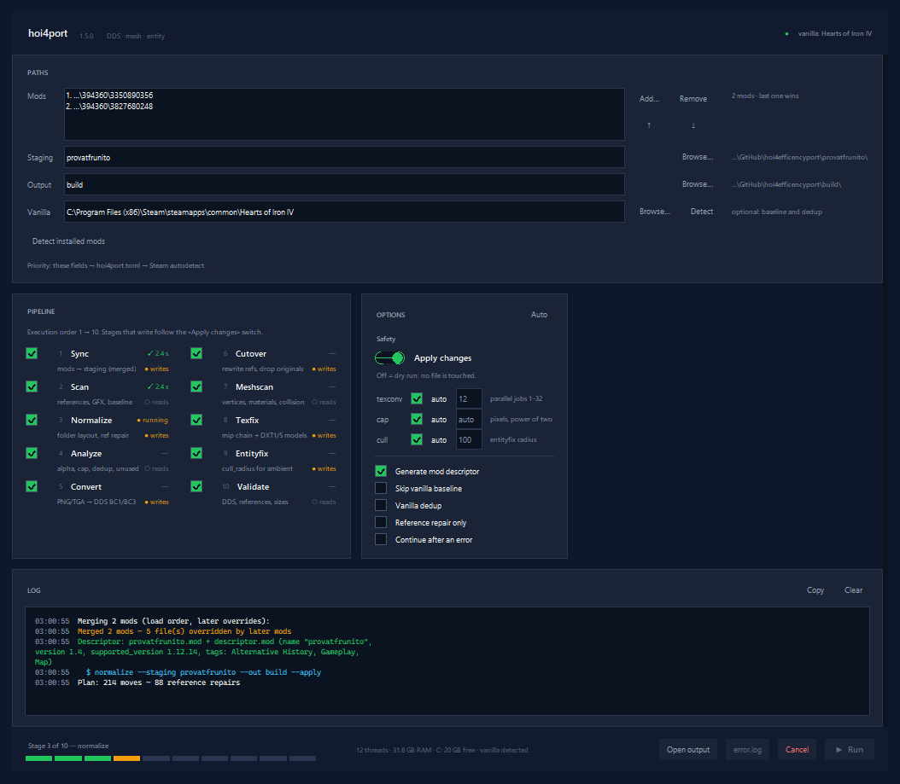

# hoi4port

Asset porting and optimization pipeline for **Hearts of Iron IV** mods:
safe mod mirroring, reference scanning, normalization, DDS conversion
(DXT1/DXT5 + mips), dedup, cutover, mesh/entity audit and validation.
One CLI, idempotent, dry-run by default.

## Install

With Python 3.11+ (any OS):

```bash
pip install hoi4port-<version>-py3-none-any.whl
```

or, without Python, download `hoi4port.exe` (Windows) from the repository
*Releases* page. `hoi4port-gui.exe` is the windowed front-end of the same
build: double-click it, no console and no Python needed.

Windows is the fully supported platform: the texture stages use
`texconv.exe` (DirectXTex, bundled with the package). On Linux/macOS all
pure-Python commands work; `convert`/`texfix`/`cutover --apply` require
Wine (invoked automatically, disable with `--no-wine`).

## Requirements

- **None** for sync/scan/normalize(dry-run)/analyze/meshscan/entityfix/validate.
- Installed Workshop mod (for `sync`) — autodetected from Steam libraries,
  otherwise pass `--mod <ID>`.
- HoI4 install (for vanilla baseline/dedup) — autodetected; without it,
  commands degrade gracefully (no baseline).

## GUI

`hoi4port gui` (or `hoi4port-gui.exe`) opens a window over the same pipeline:
the mods list, the ten stages with per-stage status, the global `Apply changes`
switch, the options, and a live log.



- **Mods** — any number of folders, in load order. `Add…`, `Remove`, `↑`/`↓`
  and `Detect installed mods` edit the list; `sync` merges them into one
  staging tree, and every following stage works on that tree. Merging is
  file-level, like the game: if two mods ship the same file
  (`common/national_focus/x.txt`, a `.gfx`, a texture) the later mod replaces
  it entirely — there is no per-key merge inside a file.
- **Every control explains itself on hover**: fields, stages, options, buttons.
- **Apply changes** is off by default: stages that write stay a dry run, and
  turning it on asks for confirmation showing the folder that will change.
- **Auto** (options card) detects logical CPUs, RAM, free space on the staging
  volume and the HoI4 install, then sets `texconv`, `cap` and `cull` — each of
  them also has its own `auto` checkbox. The detected profile stays in the
  footer, and every decision is written to the log.
- `Ctrl+Enter` runs the selected stages, `Esc` cancels the running process
  tree, `Ctrl+L` clears the log, `error.log` runs `check-log` on the game log.
- Staging/output shown as `…\tail\` are resolved, so a relative `mod_tfr` is
  never a mystery.
- The window sizes itself to the content and scrolls when the screen is
  smaller, so nothing is clipped at 100 %, 125 % or 150 % display scaling.
- The last session (mods, paths, options, window size) is stored in
  `<cache>/gui.json` (`%LOCALAPPDATA%\hoi4port` on Windows).

## Quickstart

```bash
hoi4port sync --mod 3350890356     # Workshop ID or path -> ./mod_tfr staging
hoi4port sync --mod 3350890356 --mod D:/mods/patch   # merged, patch wins
hoi4port scan                      # references, missing sprites, baseline
hoi4port meshscan                  # mesh metrics (vertices, materials, collision)
hoi4port texfix --apply            # full mip chain + DXT1/DXT5 model textures
hoi4port validate                  # final checks (exit != 0 on problems)
```

Persistent configuration: `hoi4port.toml` (see `hoi4port.example.toml`) in
the current directory or in `%APPDATA%\hoi4port\` (Windows) /
`~/.config/hoi4port/` (Linux/macOS).

Resolution order for every path:
**CLI flags -> env `HOI4PORT_MOD/STAGING/VANILLA/OUT` -> `hoi4port.toml` -> Steam autodetect.**

## Selecting the mod

Four ways to choose which mod to optimize (the first that is set wins):

```bash
hoi4port sync --mod 3350890356        # 1. flag: numeric Workshop ID...
hoi4port sync --mod "D:\path\to\mod"  #    ...or a direct folder path
set HOI4PORT_MOD=3350890356           # 2. environment variable (session)
```

```toml
# 3. hoi4port.toml — persistent default (copy from hoi4port.example.toml)
mod = "3350890356"
```

4. **No selection**: with exactly one HoI4 Workshop mod installed it is
   picked automatically; with several, `sync` lists them and asks you to
   choose with `--mod`. A numeric ID is resolved across **all** Steam
   libraries (Windows registry + `libraryfolders.vdf`, Linux, macOS).

## Commands

| Command | What it does | Modifies files? |
|---|---|---|
| `sync` | Mirror Workshop mod -> staging (`--mod <ID\|path>`) | staging only |
| `scan` | Asset references, missing GFX_*, vanilla hash baseline | no |
| `normalize` | Vanilla-style asset sorting + reference repair | `--apply` |
| `analyze` | Asset plan: alpha, cap, dedup, unused | no |
| `convert` | Per-class DDS conversion (BC1/BC3, cap, %4 padding) | `--apply` |
| `cutover` | Reference rewrite + dedup + original removal | `--apply` |
| `meshscan` | `.mesh` analysis: vertices, triangles, materials, collision | no |
| `texfix` | Model textures: full mip chain + DXT1/DXT5 | `--apply` |
| `entityfix` | Entity audit + `cull_radius` for ambient objects | `--apply` |
| `validate` | Post-cutover validation: DDS, scan, disk sizes | no |
| `check-log` | Texture/sprite errors from the game `error.log` | no |
| `gui` | Window over the pipeline (same stages, same flags) | as the stages |

Every stage writes JSON manifests/reports into `build/`; a second run is a
no-op (idempotent).

## Troubleshooting

- **"texconv not found"**: the package bundles it in `pipeline/bin/`;
  if you have your own build, set `HOI4PORT_TEXCONV=<path>`.
- **"Source mod not determined"**: pass `--mod <Workshop ID>` (the error
  lists the mods it found).
- **Vanilla not found** (non-standard Steam library): `--vanilla <path>`.
- **Game log**: `check-log` looks for `error.log` in the standard Windows
  (including OneDrive), Linux (Proton and native) and macOS locations.
- **Cache**: vanilla sprite names are cached under `%LOCALAPPDATA%\hoi4port\`
  (Linux `$XDG_CACHE_HOME/hoi4port`, macOS `~/Library/Caches/hoi4port`),
  keyed by a hash of the install's `launcher-settings.json`; a game update
  invalidates it automatically. Deleting the folder is always safe.

## License

MIT. `texconv.exe` is [DirectXTex](https://github.com/microsoft/DirectXTex) (MIT).
